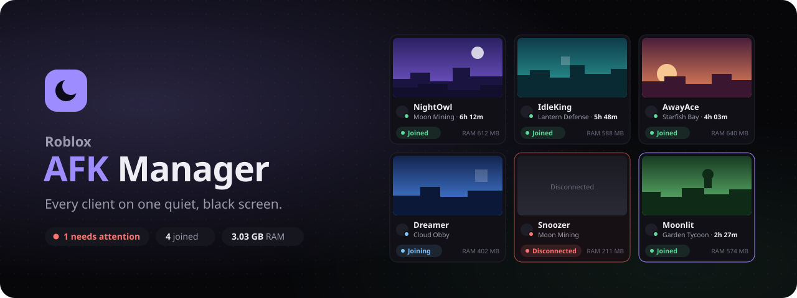
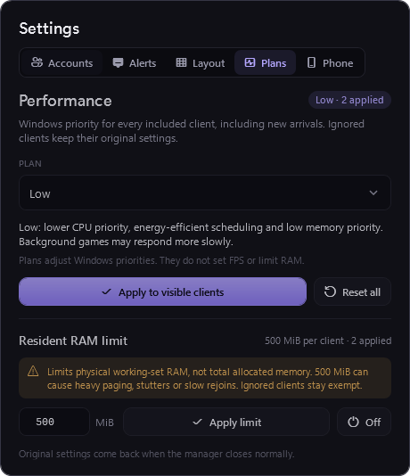
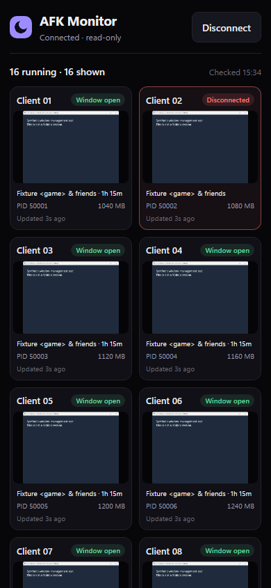

<p align="center">
  
</p>

<p align="center">
  
  
  
  
</p>

<p align="center">
  <a href="#-download">Download</a> ·
  <a href="#-features">Features</a> ·
  <a href="#-opening-accounts-optional">Opening accounts</a> ·
  <a href="#-phone-monitoring">Phone monitoring</a> ·
  <a href="#-privacy--safety">Privacy</a> ·
  <a href="#-faq">FAQ</a> ·
  <a href="#-build-from-source">Build</a>
</p>

---

**Roblox AFK Manager** is a free Windows dashboard for people who keep several Roblox clients running at once. Every client gets a live preview card with its account, game, session time and health. You can see at a glance which ones are fine and which one dropped, jump to any game with one click, keep the account you're actually playing out of the way, and check on everything from your phone.

It **watches and organizes**. It never plays for you, never asks for or stores your password, and never reads or changes game memory. An optional feature can reopen closed accounts from a saved login session; it does nothing until you add one, and it is [explained below](#-opening-accounts-optional).

<p align="center">
  
  <br><sub>The dashboard with twelve clients. Live game previews fill the dark areas when real clients are running.</sub>
</p>

## ✨ Features

### 🖥️ One screen for every client
- **Live previews** of each game, drawn by Windows itself (DWM thumbnails), not a screenshot loop.
- **Adapts to any count.** Cards rearrange to fill the window with no scrolling. Tested from 1 to 64 clients; how many your PC can actually run is up to its hardware.
- **Fill or Fit** previews: crop to fill the card, or show the whole window.
- **Click a preview** to bring that game to the front. Minimized games are restored.
- **Drag cards** to reorder them, or use `Ctrl+←` / `Ctrl+→`. Your game windows never move.

### 🌙 Health at a glance
- The header says **All clear**, **N need attention** or **N offline**, plus how many clients have joined and their combined RAM.
- Each card shows a colored status: **Joined**, **Joining**, **Disconnected**, **Possibly stuck joining**, **Not responding** or **Minimized**.
- Cards that need attention turn **red**, so you can spot a dropped client from across the room.
- **Offline** lists accounts that ran in the last 24 hours but are closed now, with their last game and when they were last seen, so you know exactly which one to open again.
- **Activity** keeps the last 100 events (disconnects, frozen windows, missing windows, recoveries), with optional silent Windows notifications.

<p align="center">
  
</p>

### 👤 Knows which account is which
- **Usernames, avatars and game names** appear automatically when the app can match a client's local Roblox log to its exact process.
- **Session timer** since the last join.
- **Rename any card** with the pencil or `F2` if automatic naming isn't available.
- **Saved profiles** remember each account's name, position, ignore choice and resource plan across restarts, keyed by Roblox user ID.

### 🙈 Ignore the account you're playing
- **Ignore** hides a client from the dashboard, bulk actions, alerts and the phone view, and restores any settings the app changed on it.
- Bring it back any time from **Ignored → Show**.

### ⚙️ Gentle resource controls
- **Low / Balanced / High** plans adjust Windows CPU priority, power scheduling and memory priority for background clients.
- An optional **resident RAM limit** (256–8192 MiB per client) for tight machines.
- Everything is restored when you choose **Reset all**, ignore a client, or close the manager normally.

<p align="center">
  
</p>

### 🚀 Opening accounts (optional)
Save a login session once, then reopen every closed account with one button, line the windows up on a grid, and have each one return to its saved position. See [Opening accounts](#-opening-accounts-optional).

### 🔔 Discord alerts (optional)
Away from your PC? The manager can message a Discord channel when something goes wrong, naming the account:

- an account's **log reports a disconnect**, including being kicked while the game keeps running
- a game **window closed** or is no longer detected (crash, or you closed it)
- a client is **not responding** or **stuck joining**
- Roblox **ended an account's login** (and whether the automatic restart worked)
- an account **came back** after one of the above. This does not send a new message: the bot **edits the original alert**, turning that account's line green with the time it returned ("back at 03:41"). When every account in a message is back, the title becomes "All accounts are back" and the mention is removed. Edits never ping again.

Open **Settings → Alerts**, paste a channel webhook address (channel settings → Integrations → Webhooks → New Webhook → Copy Webhook URL), and press **Test**. Add your Discord user ID if you want your phone to buzz: Discord only notifies you if you are mentioned, so without it messages arrive silently in the channel.

- **Only when you're away.** A chip in the header shows **At PC** or **Away**. By default the manager treats you as away after 2 minutes without keyboard or mouse input (change the time, or force Away / At PC, in **Settings → Alerts**; clicking the chip cycles the modes). At the PC nothing is sent or reopened, so closing a client yourself never pings you. When you step away, you get one quiet message listing accounts that were already down, and from then on problems ping you.
- Several events close together are sent as **one message**, so twelve accounts dropping at once is one ping, not twelve. At most 30 messages an hour.
- The webhook address is a secret. It is stored **encrypted for your Windows user**, sent only to Discord, and never logged. **Turn off** deletes it. If it ever leaks, delete the webhook in Discord.
- Messages contain account names (as shown on the cards), a short description and a time. Nothing else leaves your PC. Alerts can only mention you: nobody else, and never `@everyone`.
- Only alerts you were actually sent can be edited. A message can't be edited after you restart the manager, and an account that was only known as "Client 07" may come back under a different number, so its line stays red. Delete a message in Discord and its line is simply not updated.
- The manager also posts when it **starts** and when it is **closed normally**. If the whole PC loses power or the manager is killed, nothing can be sent, so silence is not proof that everything is fine.

### 📱 Phone monitoring
A private, read-only page for your phone: account names, game, session state, RAM and a screenshot of each client, refreshed about every 8 seconds. Tap a card to enlarge it. See [Phone monitoring](#-phone-monitoring).

## 📥 Download

1. Go to the [**Releases**](../../releases/latest) page and download `RobloxAfkManager-v<version>-win-x64.zip`.
2. Install both runtimes from [Microsoft's .NET 10 downloads](https://dotnet.microsoft.com/en-us/download/dotnet/10.0) if you don't have them:
   - **.NET Desktop Runtime 10** (x64)
   - **ASP.NET Core Runtime 10** (x64)
3. Extract the ZIP anywhere and run **`RobloxAfkManager.exe`**. Keep all files in the folder together.

No installer, no admin rights. Settings live in `%LOCALAPPDATA%\RobloxAfkManager`; delete that folder to reset everything.

> **Requirements:** Windows 10 version 1903 or newer, or Windows 11, on x64.

## 🚀 Quick start

1. Open your Roblox clients, then start the manager. Cards appear on their own.
2. Keep games **not minimized** so their previews stay live. Covering them with other windows is fine.
3. Click **Ignore** on the account you're actively playing.
4. Optional: open **Settings → Plans**, pick **Low**, and choose **Apply to visible clients** to make background clients lighter on your CPU.
5. Glance at the header. **All clear** means every included client looks healthy.

Start with two clients to get a feel for it before scaling up.

## 🎛️ Controls

| Control | What it does |
| --- | --- |
| Click preview / **Show** | Brings that game to the front. Restores it if minimized. |
| Drag a preview or name | Swaps the two cards. Game windows don't move. |
| `Ctrl+←` / `Ctrl+→` | Swaps the selected card with its neighbor. |
| Pencil / `F2` | Sets a custom account name. **Use automatic name** removes it. |
| **Fill** / **Fit** | Crops previews to fill the card, or shows the whole window. |
| **Ignore** | Hides the client and excludes it from everything else. |
| **Refresh** | Re-detects clients and retries previews. |
| **Restore windows** | Restores clients that were minimized outside the manager. |
| **Offline** | Accounts that ran recently but are closed now. Copy a name, or **Forget** one you closed on purpose. |
| **Activity** | Recent events, desktop notification toggle, Clear. |
| **Settings** | Five tabs. **Accounts**: saved logins, the game to open, Open closed / Open selected, backups. **Alerts**: Discord alerts and Away mode. **Layout**: arrange windows and save positions. **Plans**: resource plans and the RAM limit. **Phone**: phone monitoring and its access code. |
| **At PC / Away** chip | Shows when Discord alerts are active (only with Discord alerts set up). Click to switch between Automatic, Always away and At PC. |
| **Ignored** | Lists ignored clients, restores original window placements. |

## 📊 Resource plans

| Plan | CPU priority | Power scheduling | Memory priority |
| --- | --- | --- | --- |
| Low | Below normal | Energy-efficient (EcoQoS) | Low |
| Balanced | Below normal | Windows managed | Below normal |
| High | Normal | Speed throttling disabled | Normal |

Plans are Windows scheduling hints. They **don't** cap FPS or guarantee lower RAM. High never uses Windows' High or Realtime priority.

The **resident RAM limit** caps each client's physical working set, not the total memory the game allocates. Setting it too low makes Windows page memory to disk, which can cause stutters or slow rejoins. It's always off when the app starts. Turn it off if games start stuttering.

If the app is force-killed, it can't restore settings. They stay applied until each game closes.

## 🚀 Opening accounts (optional)

Everything above works without this. It only matters if you want the manager to reopen accounts that closed. Without it, the **Offline** panel still tells you which account to open by hand.

**What it does**
- Sends short alert messages (account name, what happened, when) to your Discord webhook, only if you add one.
- **Open closed** (and a per-account **Open**) starts Roblox for every saved account that isn't running, one every 10 seconds, in the game you choose.
- **Open selected** starts only the accounts you tick. **Seconds between accounts** (5 to 120, default 10) sets the gap between launches.
- **Game to open:** paste a `roblox.com/games/…` link or a place id in **Settings → Accounts**. Nothing is opened until you set one.
- **Arrange** (Settings → Layout) puts the windows on a grid on the monitor you pick, and can maximize one main client. **Save positions** remembers each window's spot, and they return there when the accounts are reopened.
- **When I'm away, reopen accounts that crash or get kicked** (off by default; Settings → Accounts). While you are away from the PC, an account whose window closes, or that was kicked and is sitting on the error screen for a minute, is started again from its saved login, in your game. It only works for accounts with a saved login. At the PC nothing is reopened, so closing a client yourself is always respected. It waits 25 seconds before reopening (so a window that blinks out is left alone), starts one account at a time using your spacing setting, reopens each account at most 3 times an hour (then it gives up and tells you) and at most 24 accounts an hour in total. If you use Discord alerts, the alert for that account turns green when it has really rejoined.
- **Restart an account when Roblox ends its login** (off by default). When a client's log shows a burst of "401 Unauthorized" answers, its login was ended and it will freeze and get kicked. The manager then closes and reopens just that account. At most 4 restarts an hour overall, and one per account every 20 minutes. Every restart is listed in **Activity**.

**How an account gets saved**
- **Log in to add an account…** opens Roblox's own login page in an embedded browser (Microsoft Edge WebView2). You type your username and password there yourself; the manager never sees them and has no password storage. When you're logged in the window closes and the account's session is saved.
- Or paste a `.ROBLOSECURITY` cookie value instead.
- The session cookie is encrypted with Windows DPAPI, so only your Windows user on this PC can read it, and stored in `%LOCALAPPDATA%\RobloxAfkManager\logins.dat`. Each account's embedded-browser profile is kept in `%LOCALAPPDATA%\RobloxAfkManager\browser`. **Remove** deletes both.
- The cookie is only ever sent to `roblox.com` addresses (to confirm who it belongs to and to get a one-time launch ticket). It is never logged or shown.

**How an account is opened**
The manager asks Roblox for a launch ticket with the saved session, then starts `RobloxPlayerBeta.exe` directly with that ticket, the same thing the website does when you press Play. It never uses the `roblox-player:` link, because Roblox's installer behind it closes every client that is already running.

**Things to know**
- **A saved session is as powerful as your password.** Anyone who can run programs as your Windows user could use it. Don't use this on a PC you share. Logging out of an account on roblox.com, or changing its password, ends the saved session and you add it again.
- **Running several Roblox clients at once** needs Roblox's single-instance check to be lifted, which this manager does not do. Use whatever you already use for that. The manager only starts the clients. If Roblox refuses a second client, the manager says so instead of failing silently.
- **Back up settings… / Restore…** (Settings → Accounts) saves and loads names, card order, ignored accounts and window positions. Logins are never included in a backup.
- Roblox's rules decide whether multiple accounts and AFK farming are allowed for the game you play. Using this tool doesn't make anything permitted. Treat it as your responsibility and read the [Terms of Use](https://en.help.roblox.com/hc/en-us/articles/115004647846).
- It sends only what the website itself would: a plain, honest `User-Agent` naming this tool, no disguise as a browser or the Roblox client, and no clicking or typing into Roblox's pages.
- An account that Roblox's own app or a browser also has logged in can be signed out by that. If an account keeps losing its login, turn on the restart option, or log in again with **Login**.

## 📱 Phone monitoring

The phone page is **read-only**: it can't click, rejoin or change anything.

1. In the manager, open **Settings → Phone → Start monitoring** and copy the access code.
2. Install [Tailscale](https://tailscale.com/download) on the PC and your phone, signed in to the same account.
3. On the PC, run:
   ```powershell
   tailscale serve --bg http://127.0.0.1:8765
   ```
4. Open the `https://…ts.net` address Tailscale prints on your phone and enter the code.

<p align="center">
  
</p>

The server only listens on your own PC (`127.0.0.1`), and Tailscale Serve keeps it private to your devices. **Never use Tailscale Funnel** or port forwarding for this. The access code changes every time monitoring restarts. Full guide: [docs/REMOTE.md](docs/REMOTE.md).

## 🔒 Privacy & safety

**What it does**
- Reads window and process information from Windows (title, position, CPU, RAM).
- Reads small sections of your **local** Roblox log files to match a client to its account ID and game.
- Asks Roblox's **public** APIs for usernames, avatar headshots and game names, sending only public IDs.
- Saves your preferences and event history locally in `%LOCALAPPDATA%\RobloxAfkManager`.

**Only if you use [Opening accounts](#-opening-accounts-optional)**
- Stores each account's session cookie, encrypted for your Windows user, and sends it only to `roblox.com` to open that account.
- Closes a client only when you turn on the restart option, and then only the account that lost its login.

**What it never does**
- ❌ Ask for, read or store your **password**. You type it into Roblox's own page.
- ❌ Read any cookie unless you add a saved login yourself.
- ❌ Inject code, read or write game memory, or automate gameplay.
- ❌ Bypass protections or stop Roblox's idle disconnect.
- ❌ Upload your logs, record video, or send data anywhere except Roblox's public APIs, your phone (if you turn monitoring on) and your own Discord channel (if you set up Discord alerts).
- ❌ Close or restart your games on its own, unless you turned on the restart option.

Before every window or resource change, it verifies that the process is still the same one it saw before (so a reused process ID can't be mistaken for another account), and it saves original settings so they can be restored.

## ❓ FAQ

**A card says "Waiting for preview" or stays black.**
The game is minimized, on another virtual desktop, or not rendering. Restore it with **Restore windows**. Windows and Roblox decide whether covered games keep drawing.

**The name shows "Client 03" instead of the username.**
Automatic naming needs the game to finish joining and checks logs at most every 30 seconds. Give it a minute, or click the pencil to type the name yourself.

**One of my accounts closed. Which one?**
Open **Offline**. It lists every account that ran in the last 24 hours but isn't running now, with its last game and when it was last seen. It tells you exactly which account to open, and **Open closed** can start it for you if you saved its login.

**Does this stop me getting kicked for being idle?**
No, by design. Roblox's idle disconnect still applies. The manager tells you when a client disconnects so you can deal with it.

**Can it launch accounts?**
Yes, if you save a login for them. See [Opening accounts](#-opening-accounts-optional). It never stores passwords and does nothing until you add a login.

**Will Low plan or the RAM limit make my PC run more clients?**
Maybe, maybe not. They change how Windows prioritizes clients. Measure on your own machine and back off if games stutter.

**Is it safe to close the manager?**
Yes. Closing it normally restores every setting it changed. Your games keep running.

**Is this against Roblox's rules?**
The app doesn't modify the game or automate play, but how you use multiple accounts is your responsibility. Read the [Roblox Terms of Use](https://en.help.roblox.com/hc/en-us/articles/115004647846) yourself.

## 🛠️ Build from source

**You need:** the [.NET 10 SDK](https://dotnet.microsoft.com/en-us/download/dotnet/10.0) (x64), Visual Studio C++ desktop build tools (MSVC v143+), and Windows SDK 10.0.26100 or newer.

```powershell
git clone <this repository>
cd <repository folder>
powershell.exe -NoProfile -ExecutionPolicy Bypass -File .\build.ps1 -Publish
```

This builds Release, runs the tests, and writes a ready-to-run folder and ZIP to `artifacts\RobloxAfkManager-v<version>-win-x64\`. Or open `RobloxAfkManager.sln` in Visual Studio and start `RobloxAfkManager.App`.

Desktop UI tests need an interactive Windows session:

```powershell
.\tests\run-desktop-tests.ps1 -Configuration Release
```

See [docs/TESTING.md](docs/TESTING.md) for all test options.

### Project layout

```text
src/RobloxAfkManager.Core/     Identity, layout, session parsing and resource-policy logic
src/RobloxAfkManager.App/      WPF app (MVVM), Win32/DWM services, phone dashboard server
src/RobloxAfkManager.Capture/  Small native Windows Graphics Capture bridge (C++)
tests/                         Deterministic, desktop UI, native and browser tests
assets/                        Original app icon artwork
tools/                         Icon export and repository privacy check
docs/                          Guides and implementation notes
```

### Docs

| Guide | About |
| --- | --- |
| [REMOTE.md](docs/REMOTE.md) | Phone monitoring setup and security |
| [SESSIONS.md](docs/SESSIONS.md) | Alerts, session states and saved profiles |
| [TESTING.md](docs/TESTING.md) | Automated and manual test procedures |
| [UI-DESIGN.md](docs/UI-DESIGN.md) | Layout and visual design conventions |
| [WIN32.md](docs/WIN32.md) | Windows, DWM and public API implementation notes |
| [REPOSITORY.md](docs/REPOSITORY.md) | Keeping personal data out of commits |

## 📝 What's new

See the [changelog](CHANGELOG.md) for patch notes on every release.

## 🤝 Contributing

Bug reports and ideas are welcome through [Issues](../../issues). Pull requests too: run `.\build.ps1` and `.\tools\Check-Repository.ps1` first, and read [REPOSITORY.md](docs/REPOSITORY.md) so no personal data slips into a commit.

Out of scope by design: gameplay automation, auto-rejoin, account launching, anti-idle tricks, memory reading and code injection.

Found a security issue? Please report it privately; see [SECURITY.md](SECURITY.md).

## 📄 License

[MIT](LICENSE). Free to use, modify and share.

<sub>Roblox AFK Manager is an independent project. It is not affiliated with, endorsed by or sponsored by Roblox Corporation. "Roblox" is a trademark of Roblox Corporation. The app icon and banner are original artwork.</sub>
