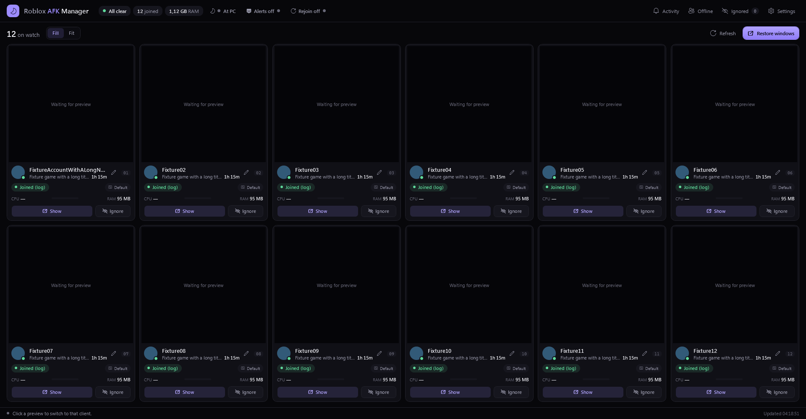
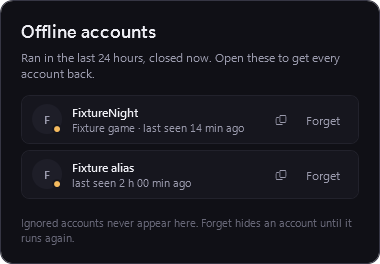

<p align="center">
  
</p>

<p align="center">
  
  
  
  
</p>

<p align="center">
  <a href="#-download">Download</a> ·
  <a href="#-features">Features</a> ·
  <a href="#-phone-monitoring">Phone monitoring</a> ·
  <a href="#-privacy--safety">Privacy</a> ·
  <a href="#-faq">FAQ</a> ·
  <a href="#-build-from-source">Build</a>
</p>

---

**Roblox AFK Manager** is a free Windows dashboard for people who keep several Roblox clients running at once. Every client gets a live preview card with its account, game, session time and health. You can see at a glance which ones are fine and which one dropped, jump to any game with one click, keep the account you're actually playing out of the way, and check on everything from your phone.

It only **watches and organizes**. It never plays for you, never touches your login, and never reads or changes game memory.

<p align="center">
  
  <br><sub>The dashboard with twelve clients. Live game previews fill the dark areas when real clients are running.</sub>
</p>

## ✨ Features

### 🖥️ One screen for every client
- **Live previews** of each game, drawn by Windows itself (DWM thumbnails), not a screenshot loop.
- **Adapts to any count.** Cards rearrange to fill the window with no scrolling. Tested from 1 to 64 clients; how many your PC can actually run is up to its hardware.
- **Fill or Fit** previews: crop to fill the card, or show the whole window.
- **Click a preview** to bring that game to the front. Minimized games are restored.
- **Drag cards** to reorder them, or use `Ctrl+←` / `Ctrl+→`. Your game windows never move.

### 🌙 Health at a glance
- The header says **All clear**, **N need attention** or **N offline**, plus how many clients have joined and their combined RAM.
- Each card shows a colored status: **Joined**, **Joining**, **Disconnected**, **Possibly stuck joining**, **Not responding** or **Minimized**.
- Cards that need attention turn **red**, so you can spot a dropped client from across the room.
- **Offline** lists accounts that ran in the last 24 hours but are closed now, with their last game and when they were last seen, so you know exactly which one to open again.
- **Activity** keeps the last 100 events (disconnects, frozen windows, missing windows, recoveries), with optional silent Windows notifications.

<p align="center">
  
</p>

### 👤 Knows which account is which
- **Usernames, avatars and game names** appear automatically when the app can match a client's local Roblox log to its exact process.
- **Session timer** since the last join.
- **Rename any card** with the pencil or `F2` if automatic naming isn't available.
- **Saved profiles** remember each account's name, position, ignore choice and resource plan across restarts, keyed by Roblox user ID.

### 🙈 Ignore the account you're playing
- **Ignore** hides a client from the dashboard, bulk actions, alerts and the phone view, and restores any settings the app changed on it.
- Bring it back any time from **Ignored → Show**.

### ⚙️ Gentle resource controls
- **Low / Balanced / High** plans adjust Windows CPU priority, power scheduling and memory priority for background clients.
- An optional **resident RAM limit** (256–8192 MiB per client) for tight machines.
- Everything is restored when you choose **Reset all**, ignore a client, or close the manager normally.

<p align="center">
  
</p>

### 📱 Phone monitoring
A private, read-only page for your phone: account names, game, session state, RAM and a screenshot of each client, refreshed about every 8 seconds. Tap a card to enlarge it. See [Phone monitoring](#-phone-monitoring).

## 📥 Download

1. Go to the [**Releases**](../../releases/latest) page and download `RobloxAfkManager-v<version>-win-x64.zip`.
2. Install both runtimes from [Microsoft's .NET 10 downloads](https://dotnet.microsoft.com/en-us/download/dotnet/10.0) if you don't have them:
   - **.NET Desktop Runtime 10** (x64)
   - **ASP.NET Core Runtime 10** (x64)
3. Extract the ZIP anywhere and run **`RobloxAfkManager.exe`**. Keep all files in the folder together.

No installer, no admin rights. Settings live in `%LOCALAPPDATA%\RobloxAfkManager`; delete that folder to reset everything.

> **Requirements:** Windows 10 version 1903 or newer, or Windows 11, on x64.

## 🚀 Quick start

1. Open your Roblox clients, then start the manager. Cards appear on their own.
2. Keep games **not minimized** so their previews stay live. Covering them with other windows is fine.
3. Click **Ignore** on the account you're actively playing.
4. Optional: open **Plans**, pick **Low**, and choose **Apply to visible clients** to make background clients lighter on your CPU.
5. Glance at the header. **All clear** means every included client looks healthy.

Start with two clients to get a feel for it before scaling up.

## 🎛️ Controls

| Control | What it does |
| --- | --- |
| Click preview / **Show** | Brings that game to the front. Restores it if minimized. |
| Drag a preview or name | Swaps the two cards. Game windows don't move. |
| `Ctrl+←` / `Ctrl+→` | Swaps the selected card with its neighbor. |
| Pencil / `F2` | Sets a custom account name. **Use automatic name** removes it. |
| **Fill** / **Fit** | Crops previews to fill the card, or shows the whole window. |
| **Ignore** | Hides the client and excludes it from everything else. |
| **Refresh** | Re-detects clients and retries previews. |
| **Restore windows** | Restores clients that were minimized outside the manager. |
| **Offline** | Accounts that ran recently but are closed now. Copy a name, or **Forget** one you closed on purpose. |
| **Activity** | Recent events, desktop notification toggle, Clear. |
| **Plans** | Resource plans and the RAM limit. |
| **Mobile** | Starts or stops phone monitoring and shows the access code. |
| **Ignored** | Lists ignored clients, restores original window placements. |

## 📊 Resource plans

| Plan | CPU priority | Power scheduling | Memory priority |
| --- | --- | --- | --- |
| Low | Below normal | Energy-efficient (EcoQoS) | Low |
| Balanced | Below normal | Windows managed | Below normal |
| High | Normal | Speed throttling disabled | Normal |

Plans are Windows scheduling hints. They **don't** cap FPS or guarantee lower RAM. High never uses Windows' High or Realtime priority.

The **resident RAM limit** caps each client's physical working set, not the total memory the game allocates. Setting it too low makes Windows page memory to disk, which can cause stutters or slow rejoins. It's always off when the app starts. Turn it off if games start stuttering.

If the app is force-killed, it can't restore settings. They stay applied until each game closes.

## 📱 Phone monitoring

The phone page is **read-only**: it can't click, rejoin or change anything.

1. In the manager, open **Mobile → Start monitoring** and copy the access code.
2. Install [Tailscale](https://tailscale.com/download) on the PC and your phone, signed in to the same account.
3. On the PC, run:
   ```powershell
   tailscale serve --bg http://127.0.0.1:8765
   ```
4. Open the `https://…ts.net` address Tailscale prints on your phone and enter the code.

<p align="center">
  
</p>

The server only listens on your own PC (`127.0.0.1`), and Tailscale Serve keeps it private to your devices. **Never use Tailscale Funnel** or port forwarding for this. The access code changes every time monitoring restarts. Full guide: [docs/REMOTE.md](docs/REMOTE.md).

## 🔒 Privacy & safety

**What it does**
- Reads window and process information from Windows (title, position, CPU, RAM).
- Reads small sections of your **local** Roblox log files to match a client to its account ID and game.
- Asks Roblox's **public** APIs for usernames, avatar headshots and game names, sending only public IDs.
- Saves your preferences and event history locally in `%LOCALAPPDATA%\RobloxAfkManager`.

**What it never does**
- ❌ Ask for, read or store passwords, cookies or login tokens.
- ❌ Inject code, read or write game memory, or automate gameplay.
- ❌ Bypass protections or stop Roblox's idle disconnect.
- ❌ Upload your logs, record video, or send data anywhere except Roblox's public APIs (and your phone, if you turn monitoring on).
- ❌ Minimize, suspend, close or restart your games.

Before every window or resource change, it verifies that the process is still the same one it saw before (so a reused process ID can't be mistaken for another account), and it saves original settings so they can be restored.

## ❓ FAQ

**A card says "Waiting for preview" or stays black.**
The game is minimized, on another virtual desktop, or not rendering. Restore it with **Restore windows**. Windows and Roblox decide whether covered games keep drawing.

**The name shows "Client 03" instead of the username.**
Automatic naming needs the game to finish joining and checks logs at most every 30 seconds. Give it a minute, or click the pencil to type the name yourself.

**One of my accounts closed. Which one?**
Open **Offline**. It lists every account that ran in the last 24 hours but isn't running now, with its last game and when it was last seen. The manager can't log in for you, but it tells you exactly which account to open.

**Does this stop me getting kicked for being idle?**
No, by design. Roblox's idle disconnect still applies. The manager tells you when a client disconnects so you can deal with it.

**Can it rejoin or launch accounts automatically?**
No. That would need your login cookies, which this app deliberately never touches.

**Will Low plan or the RAM limit make my PC run more clients?**
Maybe, maybe not. They change how Windows prioritizes clients. Measure on your own machine and back off if games stutter.

**Is it safe to close the manager?**
Yes. Closing it normally restores every setting it changed. Your games keep running.

**Is this against Roblox's rules?**
The app doesn't modify the game or automate play, but how you use multiple accounts is your responsibility. Read the [Roblox Terms of Use](https://en.help.roblox.com/hc/en-us/articles/115004647846) yourself.

## 🛠️ Build from source

**You need:** the [.NET 10 SDK](https://dotnet.microsoft.com/en-us/download/dotnet/10.0) (x64), Visual Studio C++ desktop build tools (MSVC v143+), and Windows SDK 10.0.26100 or newer.

```powershell
git clone <this repository>
cd <repository folder>
powershell.exe -NoProfile -ExecutionPolicy Bypass -File .\build.ps1 -Publish
```

This builds Release, runs the tests, and writes a ready-to-run folder and ZIP to `artifacts\RobloxAfkManager-v<version>-win-x64\`. Or open `RobloxAfkManager.sln` in Visual Studio and start `RobloxAfkManager.App`.

Desktop UI tests need an interactive Windows session:

```powershell
.\tests\run-desktop-tests.ps1 -Configuration Release
```

See [docs/TESTING.md](docs/TESTING.md) for all test options.

### Project layout

```text
src/RobloxAfkManager.Core/     Identity, layout, session parsing and resource-policy logic
src/RobloxAfkManager.App/      WPF app (MVVM), Win32/DWM services, phone dashboard server
src/RobloxAfkManager.Capture/  Small native Windows Graphics Capture bridge (C++)
tests/                         Deterministic, desktop UI, native and browser tests
assets/                        Original app icon artwork
tools/                         Icon export and repository privacy check
docs/                          Guides and implementation notes
```

### Docs

| Guide | About |
| --- | --- |
| [REMOTE.md](docs/REMOTE.md) | Phone monitoring setup and security |
| [SESSIONS.md](docs/SESSIONS.md) | Alerts, session states and saved profiles |
| [TESTING.md](docs/TESTING.md) | Automated and manual test procedures |
| [UI-DESIGN.md](docs/UI-DESIGN.md) | Layout and visual design conventions |
| [WIN32.md](docs/WIN32.md) | Windows, DWM and public API implementation notes |
| [REPOSITORY.md](docs/REPOSITORY.md) | Keeping personal data out of commits |

## 🤝 Contributing

Bug reports and ideas are welcome through [Issues](../../issues). Pull requests too: run `.\build.ps1` and `.\tools\Check-Repository.ps1` first, and read [REPOSITORY.md](docs/REPOSITORY.md) so no personal data slips into a commit.

Out of scope by design: gameplay automation, auto-rejoin, account launching, anti-idle tricks, memory reading and code injection.

Found a security issue? Please report it privately; see [SECURITY.md](SECURITY.md).

## 📄 License

[MIT](LICENSE). Free to use, modify and share.

<sub>Roblox AFK Manager is an independent project. It is not affiliated with, endorsed by or sponsored by Roblox Corporation. "Roblox" is a trademark of Roblox Corporation. The app icon and banner are original artwork.</sub>
